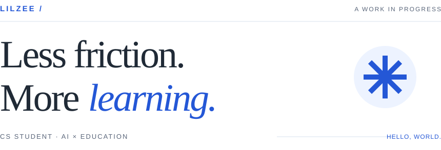

<picture>
  <source media="(prefers-color-scheme: dark)" srcset="./assets/editorial-header-dark.svg">
  
</picture>

我是 Zee，CS 在读。我在做两件事：让 **AI Agent 接入真实工具、把事做完**，也让 **AI 陪人把学习坚持下去**。

[关于我](https://github.com/LilZeeCN) · [全部仓库](https://github.com/LilZeeCN?tab=repositories) · [发邮件](mailto:2453972231@qq.com)

---

### Selected Work

| 项目 | 一句话 | 做什么 | 技术 |
| :--- | :--- | :--- | :--- |
| **[zee-rp](https://github.com/LilZeeCN/zee-rp)** | 让 AI 画出原型，在 Axure 里继续改。 | 能读写、生成原生 Axure `.rp` 的引擎与 MCP server：用 RP/1 源码描述页面与交互，编译出能接着改的 `.rp`；也能读改已有工程、按截图重建布局。 | 开源引擎 · MCP Server · MIT |
| **[agy-argon-bridge](https://github.com/LilZeeCN/agy-argon-bridge)** | 把 Antigravity CLI 接到 Vertex AI 的旗舰模型。 | 本地桥接服务：协议转换与企业级鉴权接入 `gemini-4-argon`，支持完整 Tool Calling、多账号轮换与长思考守护。 | Python · Vertex AI |
| **[youtube-summary](https://github.com/LilZeeCN/youtube-summary)** | 看完视频，带走可回看的知识。 | Chrome 扩展：为 YouTube / B 站生成带时间戳的总结、可点击导图与追问对话，并用跨视频长期记忆把看过的内容连起来。 | JavaScript · Chrome 扩展 |
| **[zee-tutor](https://github.com/LilZeeCN/zee-tutor)** | 让课程不止停在对话里。 | Claude Code 学习 Skill：按目标与证据规划课程，把章节、练习、测评与进度沉淀为 Markdown Wiki。 | Python · Claude Code Skill |

---

### 一条主线

> 让 AI 接入真实工具，也让 AI 学会如何教学。

- **[DeepTutor](https://github.com/HKUDS/DeepTutor)** — 参与 40k+ stars 的开源 AI 教学平台，[PR #1388](https://github.com/HKUDS/DeepTutor/pull/1388) 已合并
- **[lexiary](https://github.com/LilZeeCN/lexiary)** — Android 生词手账：读到哪，记到哪
- **[cs61b-cn](https://github.com/LilZeeCN/cs61b-cn)** — UC Berkeley CS 61B 数据结构中文版骨架代码

### 最近在忙什么

<!--START_SECTION:activity-->
1. ❌ Closed issue [#2](https://github.com/LilZeeCN/zee-rp/issues/2) in [LilZeeCN/zee-rp](https://github.com/LilZeeCN/zee-rp)
2. ❌ Closed issue [#1](https://github.com/LilZeeCN/zee-rp/issues/1) in [LilZeeCN/zee-rp](https://github.com/LilZeeCN/zee-rp)
3. 💪 Opened PR [#4](https://github.com/LilZeeCN/zee-rp/pull/4) in [LilZeeCN/zee-rp](https://github.com/LilZeeCN/zee-rp)
<!--END_SECTION:activity-->

<picture>
  <source media="(prefers-color-scheme: dark)" srcset="https://raw.githubusercontent.com/LilZeeCN/LilZeeCN/anim/github-contribution-grid-snake-dark.svg">
  <source media="(prefers-color-scheme: light)" srcset="https://raw.githubusercontent.com/LilZeeCN/LilZeeCN/anim/github-contribution-grid-snake.svg">
  
</picture>

Built with curiosity. Shared with you. &nbsp;/&nbsp; <a href="mailto:2453972231@qq.com">Say hello ↗</a>
