CS 在读。我在做两类东西：让 **AI Agent 接进真实工具干活**，也让 **AI 陪人把学习走完**。 
从生成原生 Axure 原型、桥接云端旗舰模型，到视频知识整理与可持续课程 Wiki——把想法做出来，再慢慢打磨。

[Projects](https://github.com/LilZeeCN?tab=repositories) · [Email](mailto:2453972231@qq.com)

 

01 / SELECTED WORK — LIVE

<table>
<tr>
<td width="50%" valign="top">
01 — AI × DESIGN TOOLS · MCP
<h3><a href="https://github.com/LilZeeCN/zee-rp">zee-rp ↗</a></h3>

让 AI 画出原型，在 Axure 里继续改。 开源引擎与 MCP server：用 RP/1 源码生成带页面、变量和交互的原生 <code>.rp</code>，也能读改现有工程、从截图重建原型。

Python · Node.js · MCP · Axure RP
</td>
<td width="50%" valign="top">
02 — AGENT INFRASTRUCTURE
<h3><a href="https://github.com/LilZeeCN/agy-argon-bridge">agy-argon-bridge ↗</a></h3>

把 Antigravity CLI 接到云端旗舰模型。 本地桥接服务：将 <code>agy</code> 接入 Vertex AI 的 <code>gemini-4-argon</code>，支持完整 Tool Calling、多账号轮换与长思考防断守护。

Python · Vertex AI · Gemini · Streaming
</td>
</tr>
<tr>
<td width="50%" valign="top">
03 — LEARNING FROM VIDEO
<h3><a href="https://github.com/LilZeeCN/youtube-summary">youtube-summary ↗</a></h3>

看完视频，带走可回看的知识。 Chrome 扩展，为 YouTube 和 B站生成带时间戳的总结、思维导图与追问对话；长期记忆让它关联你看过的视频，而不是每个视频都从零开始。

Chrome Extension · JavaScript · YouTube · Bilibili
</td>
<td width="50%" valign="top">
04 — WIKI-BASED LEARNING
<h3><a href="https://github.com/LilZeeCN/zee-tutor">zee-tutor ↗</a></h3>

让课程不止停在对话里。 Claude Code 学习 Skill，基于学习证据规划课程、练习与测评，并把目标、章节和进度整理成可持续维护的 Markdown Wiki。

Claude Code Skill · Python · Markdown · Learning
</td>
</tr>
</table>

 

02 / THE THREAD

### 让 AI 接入真实工具，也让 AI 学会如何教学。

一边是工具：打通协议、格式与模型的边界，让 Agent 真的能交付文件和结果。 
另一边是学习：把一次性的对话，变成能积累、能复习、能验证的长期过程。

这是这四个项目背后，同一个想继续探索的问题。

 

03 / RECENT ACTIVITY

<!--START_SECTION:activity-->
1. ❌ Closed issue [#2](https://github.com/LilZeeCN/zee-rp/issues/2) in [LilZeeCN/zee-rp](https://github.com/LilZeeCN/zee-rp)
2. ❌ Closed issue [#1](https://github.com/LilZeeCN/zee-rp/issues/1) in [LilZeeCN/zee-rp](https://github.com/LilZeeCN/zee-rp)
3. 💪 Opened PR [#4](https://github.com/LilZeeCN/zee-rp/pull/4) in [LilZeeCN/zee-rp](https://github.com/LilZeeCN/zee-rp)
<!--END_SECTION:activity-->

 

<picture>
  <source media="(prefers-color-scheme: dark)" srcset="https://raw.githubusercontent.com/LilZeeCN/LilZeeCN/anim/github-contribution-grid-snake-dark.svg">
  <source media="(prefers-color-scheme: light)" srcset="https://raw.githubusercontent.com/LilZeeCN/LilZeeCN/anim/github-contribution-grid-snake.svg">
  
</picture>

 

04 / ALSO

- **[DeepTutor](https://github.com/HKUDS/DeepTutor)** — 参与 40k+ stars 的开源 AI 教学平台，[PR #1388](https://github.com/HKUDS/DeepTutor/pull/1388) 已合并
- **[lexiary](https://github.com/LilZeeCN/lexiary)** — Android 生词手账：读到哪，记到哪
- **[cs61b-cn](https://github.com/LilZeeCN/cs61b-cn)** — UC Berkeley CS 61B 数据结构中文版骨架代码

---

Built with curiosity. Shared with you. &nbsp; / &nbsp; <a href="mailto:2453972231@qq.com">Say hello ↗</a>
